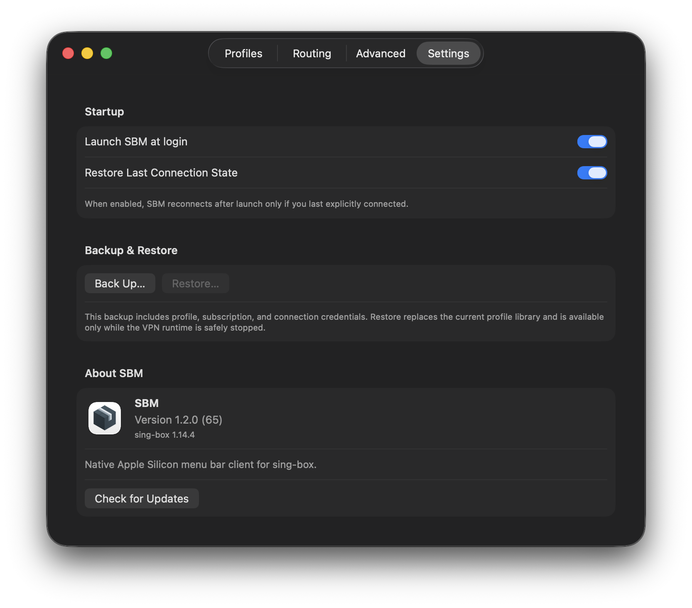

# SBM

SBM is a native macOS menu-bar VPN client for Apple silicon, built around one pinned sing-box release.

[English](README.md) · [Русский](README_RU.md) · [简体中文](README_ZH-CN.md)

## Features

- Managed TUN VPN with Rule, Global and Direct routing modes.
- Managed VLESS over the supported TCP, HTTP, gRPC, WebSocket, QUIC and HTTPUpgrade forms; Hysteria2 over TLS; and Shadowsocks SIP002 without plugins.
- Local profiles and HTTPS subscriptions; choose a server manually or use Auto.
- Server latency checks and routing rules for websites and applications.
- Direct and proxy DNS settings, including custom DNS-over-HTTPS URLs.

SBM does not import arbitrary sing-box JSON or expose every sing-box feature.

## Requirements

- Apple silicon Mac running macOS 26 or later.
- macOS approval for SBM's background helper when requested.
- The app is ad-hoc signed and is not notarized or signed with Developer ID.

Download only from [SBM GitHub Releases](https://github.com/stillnotfree/SBM/releases). Releases include a signed `.update.json` publisher proof. Because macOS may warn about an ad-hoc app, continue past the warning only if you trust the source and the exact downloaded release. Do not disable Gatekeeper or System Integrity Protection.

## Install or update

1. Download `SBM-<version>-arm64.dmg` from GitHub Releases and open it in Finder.
2. Drag `SBM.app` to Applications. When updating, choose **Replace**.
3. Open SBM and approve its background helper in macOS if prompted.
4. Connect, confirm traffic works, then disconnect once to verify both controls.

Updates replace the app through Finder; SBM does not silently replace itself. Helper installation or update may briefly disconnect the VPN.

## Screenshots


Additional settings:




## Build from source

Build on an Apple silicon Mac with macOS 26 or later, Xcode command-line tools, the Swift toolchain selected by Xcode, and an installed Go distribution with permission to download toolchains. The core recipe selects the pinned Go 1.26.10 compiler through GOTOOLCHAIN.

```sh
make build
```

This builds the app and pinned sing-box 1.14.4 locally. It does not install the app or create the privately signed release proof. See the [read-only performance measurement procedure](docs/PERFORMANCE.md) for local profiling.

## License and security

SBM is distributed under the [MIT License](LICENSE). Third-party notices are in [THIRD_PARTY_NOTICES.md](THIRD_PARTY_NOTICES.md). The bundled core is [sing-box](https://github.com/SagerNet/sing-box).

The project has used AI-assisted development under human direction and review. It has not received an independent professional security audit. See [SECURITY.md](SECURITY.md) to report a vulnerability privately.
