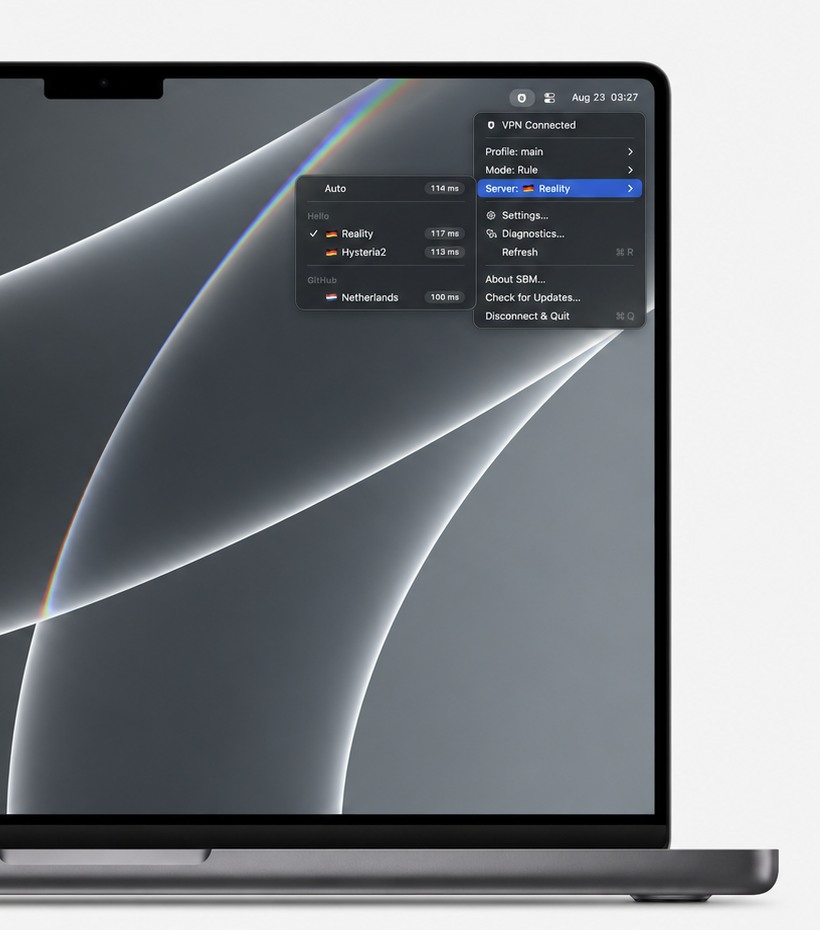
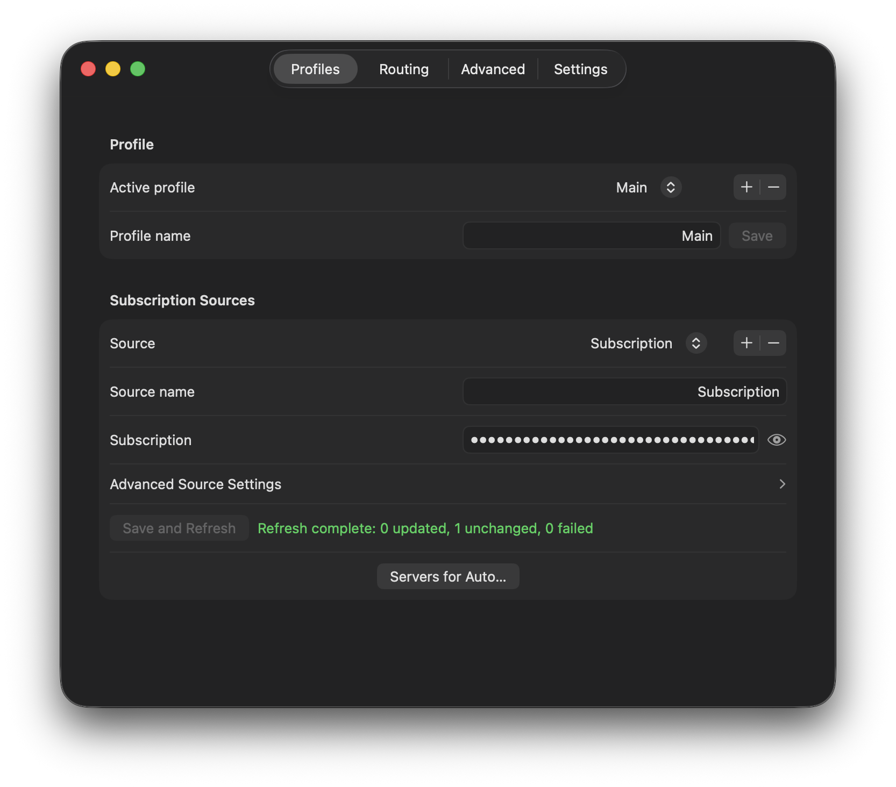
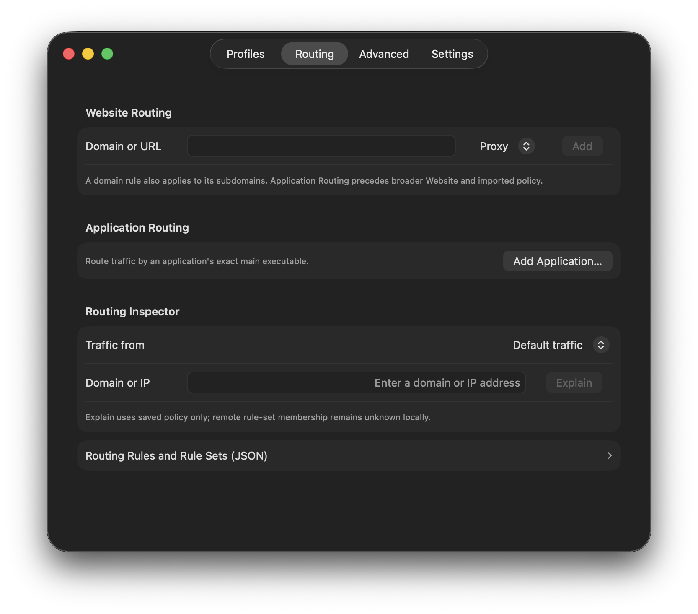
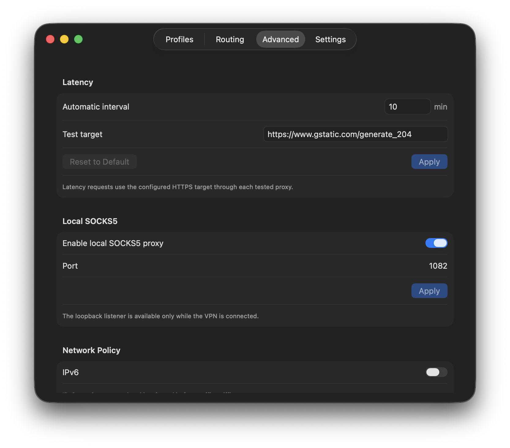

<p align="center">
  
</p>

<h1 align="center">SBM</h1>

<p align="center">
  面向 macOS、仅支持 Apple Silicon 的极简原生 sing-box 客户端。
</p>

<p align="center">
  <a href="https://github.com/stillnotfree/SBM/releases/latest"></a>
  <a href="https://github.com/stillnotfree/SBM/releases"></a>
  
  
  <a href="LICENSE"></a>
</p>

<p align="center">
  <a href="README.md">English</a> · <a href="README_RU.md">Русский</a> · 简体中文
</p>

<p align="center">
  仅使用 TUN 的 VLESS + REALITY/TCP、受支持的 VLESS TLS/gRPC 子集、Hysteria2、
  Shadowsocks、HTTPS 订阅、原生 sing-box JSON，以及按网站或应用划分的路由。
</p>

## 截图

<p align="center">
  
</p>

<details>
<summary><strong>更多截图</strong></summary>

<br>

<div align="center">
  
  
  
</div>

</details>

> **开发说明：** 本项目主要由 OpenAI Codex AI 编程代理在人工指导下生成，
> 并经过人工审查和测试。项目没有接受独立的专业安全审计。

除非发行说明明确声明某项功能，否则本文档描述当前源代码树，
不声称该功能已经包含在 v1.1.15 发行版中。

## 主要功能

- 原生 Swift 菜单栏应用，仅使用 TUN 连接，不依赖 Electron。
- Rule、Global、Direct 模式，支持自动或手动选择服务器。
- 一个可选配置文件中支持多个 HTTPS 订阅，以及 VLESS/Hysteria2/Shadowsocks 链接。
- 按源分组并保持订阅顺序的服务器菜单，带延迟标记和 exclude regex 过滤器。
- 每个订阅独立设置 User-Agent、X-App-Version、X-Device-OS 和 X-HWID。
- 支持精确的应用级 DIRECT、当前代理、固定服务器或 REJECT 路由。
- 无需编辑 JSON 即可按配置文件设置网站到 Proxy、Direct 或 Reject 的路由。
- 本地、无探测的 Routing Inspector，用于解释确定性的组合规则。
- 对紧凑链接未覆盖的协议提供原生 sing-box JSON 配置文件。
- 始终可用的诊断窗口，保存最多 50 条有界、去重和脱敏的近期错误。
- 没有系统代理模式、仪表盘、流量统计、遥测或访问日志。
- 一个默认关闭的全局 IPv6 策略：让 IPv6 继续由受管 TUN 捕获，或在流量嗅探前在本地失败关闭。

## 安装

1. 从 [GitHub Releases](https://github.com/stillnotfree/SBM/releases/latest) 下载最新的 Apple Silicon DMG。
2. 打开 DMG，将 **SBM.app** 拖到 Applications。
3. 如果 Gatekeeper 阻止启动，请使用 **System Settings > Privacy & Security > Open Anyway**。
4. 打开 **Settings…**，添加订阅、连接链接或 sing-box JSON 配置文件。

SBM 会在登录时启动，并自动连接所选的缓存配置文件。
有关后台助手批准和测试，请参阅[安装与测试](#安装与测试)。

## 配置文件源

一个受管理的配置文件可以组合：

- 多个紧凑 HTTPS URI 订阅；
- 多个 `vless://`、`hysteria2://`、`hy2://` 或 `ss://` 连接链接。

每个 HTTPS 源都有独立可编辑的 `User-Agent`、`X-App-Version`、`X-Device-OS`
和 `X-HWID`。新源会复现用户捕获的 Happ 5.4.0 iOS 请求中的稳定客户端标识字段。
SBM 不会臆造设备型号、系统版本、区域设置或传输标头，所有字段都可以在同步前替换。
重置请求预设不会改变源 HWID；复制或明确重新生成 HWID 的操作单独提供，生成值使用规范 UUID
字符串。SBM 不声称复现 Happ 的内部生成算法。刷新或更新应用时不会轮换 HWID。

每个源还可以设置可选的区分大小写的 `Exclude regex`。可以使用 `(?i)` 等内联标志实现忽略大小写。
匹配的连接名称会在菜单、Auto 分组和 sing-box 配置生成前被移除。服务器菜单保持源和节点在
订阅/配置文件中的顺序；延迟只作为元数据显示，不会改变手动选择项的顺序。跨源跳转时会删除
敏感的提供商标头。重复连接链接会合并，每个受管理配置文件最多包含 63 个代理连接。

受管理的连接使用类型化稳定 ID。v1.1.11 布局（schema 1）的配置文件库会通过单向 DTO 边界自动迁移；
紧接的 schema 4 也会在使用前原子地重写为当前 schema 5。订阅刷新时，如果节点只是重命名或重新排序、
连接身份没有改变，则保留其 ID；仅因这种变化不会重新激活活动的受管理配置文件。发生变化的 outbound
或路由策略会先验证并保存为期望状态，同时保留已知良好的运行时；**Reconnect to Apply** 会执行明确的
停止和启动。

紧凑 Shadowsocks 链接仅接受不带插件的严格 SIP002 `ss://` URI。支持的方法仅为
`aes-128-gcm`、`aes-256-gcm`、`chacha20-ietf-poly1305`、`2022-blake3-aes-128-gcm`、
`2022-blake3-aes-256-gcm` 和 `2022-blake3-chacha20-poly1305`。插件、任何查询参数以及旧式的完整 URI
Base64 形式都会被拒绝。紧凑链接支持不代表支持任意 Shadowsocks 或其他协议配置；当所需配置受到
内置 core 和 SBM 导入策略支持时，请使用单独的原生 sing-box JSON 配置文件。

此外，应用接受：

- 来自本地文件的原生 sing-box JSON 配置文件；
- 来自 HTTPS URL 的原生 sing-box JSON 配置文件。

原生 JSON 会作为独立配置文件保存，不会与紧凑源合并。

## 延迟目标与隐私

在 **Settings… > Advanced** 中设置 **Test target** HTTPS URL，然后选择 **Apply** 保存。SBM 只接受不含凭据
或片段的绝对 HTTPS URL。VPN 连接时，延迟测试会通过每个被测试的代理向该目标发送 HTTPS 请求；请选择
你信任的端点。端点运营者可以看到请求时间和代理出口地址，这与向该端点发送任意 HTTPS 请求相同。
延迟测量目标与 Auto 选择使用的 sing-box URLTest 间隔相互独立。手动测试会立即使用新应用的目标；
SBM 创建的 Auto 组在下一次正常连接时使用它。导入的原生 URLTest outbound 保持不变。

始终可用的 Diagnostics 窗口可以将有界的支持快照复制为文本或按键排序的 JSON，最多保留 50 条经过清理的
近期错误，并进行连续去重。它只聚合已经观察到的状态，不运行 DNS、网络、延迟或进程探测。配置文件和
节点名称/ID、订阅数据、标头、凭据、原始原生 JSON 和日志不会被包含。错误在保存和导出时都会清理；
过大的历史会确定性地截断，同时保留当前状态。

菜单中的 **Refresh** 会刷新已观察到的 helper 状态，并让所有符合条件的远程订阅源各同步一次，不重启 VPN。
重复的手动刷新会合并；有实质变化的活动配置文件会通过正常的运行时协调器验证并保存，同时保留已知良好的
运行时。**Reconnect to Apply** 会明确停止并启动最新的延迟候选配置。轮到某个源之前，如果它被删除或编辑，
则不会使用旧 URL 或标头请求它。激活失败时，有效的刷新数据仍会保存以便重试，更新的路由编辑也会保留；
界面会区分已保存状态和之前已知良好的活动运行时。固定的 sing-box 1.13.19 接口通过 `update_interval`
提供远程 rule-set 的定期更新，但没有受支持的有界操作来强制刷新正在运行的 rule-set，因此 **Refresh** 不声称
执行该操作。

受管理订阅和单独链接可以与用户拥有的路由 JSON 结合。该文件只能包含 `route.rules` 和远程
`route.rule_set` 条目。订阅刷新时会保留它，但只能将流量路由到 `direct` 或当前菜单选中的服务器。
应用不会代表用户下载、生成或修改地缘政治列表。

Website Routing 是配置文件级功能，最多支持 128 个标准化主机名，匹配精确 apex 和其子域名，目标可为
Proxy、Direct 或 Reject。优先级为：强制 SBM 安全规则、Website Routing、Application Routing、导入的路由，
最后是最终路由。Direct 网站规则使用匹配的本地 DNS 策略；Proxy 保留远程/代理 DNS，Reject 不会创建物理绕过。

Application Routing 使用所选 macOS `.app` 的精确主可执行文件。它位于网站规则之后、导入路由之前，可以目标为
DIRECT、当前代理选择器、一个稳定的受管理服务器或原生 REJECT。移动或删除的应用仍会显示但处于非活动状态；
SBM 不会按名称猜测，也不会扫描 bundle 中的其他可执行文件。应用规则不会创建单独的 DNS 策略。

Routing Inspector 会根据最终组合路由解释确定性的域名或 IP 决策；对于没有解析地址的主机名，
它不执行 DNS，而是探索有界的 IPv4/IPv6 和私有/公有符号分支，并在每个可能结果旁显示条件。
不执行网络、进程或持久化探测。
`Default traffic` 表示不匹配应用覆盖规则的流量；选择应用后会使用其精确保存的可执行文件路径进行评估。
主要结果为 PROXY、DIRECT 或 REJECT。对于远程 rule-set，helper 读取确切的活动 sing-box 缓存，并调用固定 core
的有界 `rule-set match` 命令；Explain 不会下载列表，IPC 只传递匹配布尔值。如果配置文件未激活、缓存不存在，
或者符号分析后仍需要端口、嗅探协议或无关的进程上下文，Inspector 会明确指出具体限制。

[`Examples/routing-ru-direct.json`](Examples/routing-ru-direct.json) 是一个最小的可选示例：俄罗斯域名和 IP
范围直连，`google.ru` 仍走代理，其余流量遵循选定的 VPN 服务器。示例中的三个官方 SagerNet rule-set 由 sing-box
通过选定代理获取并每日刷新。Rule 模式的 DNS 遵循同样的直连域名规则，因此俄罗斯目标不会通过代理解析。

原生配置文件保留自己的 outbound、DNS、路由规则和远程 rule-set。菜单会动态发现 selector 成员。当配置文件
没有 selector 或 URLTest 组时，应用会创建本地 selector 和 `Auto` 组。不会捆绑或静默注入地缘政治规则数据库。

特权 helper 始终拥有 TUN inbound、可选的仅回环 SOCKS5 监听器、warning 日志、缓存和仅回环的 Clash API。
导入的本地监听器、服务、文件系统路径、系统管理端点和暴露的控制 API 会被拒绝或替换。内置 core 支持的安全
用户态 outbound 和 endpoint 会被保留。导入的 DNS、route、outbound、endpoint、TLS 和 transport 部分必须使用
本 SBM 构建明确支持的安全字段。可能启动其他进程、创建监听器、选择系统管理端点或读写任意本地路径的能力
都会被拒绝。包含运行时 API secret 的完整候选配置必须在停止工作 core 前通过内置 `sing-box check`。运行时
激活失败会恢复之前工作的配置和 core。

在 Rule 模式中，导入的 DNS 服务器和路由规则在 SBM 的强制和一等路由层之下仍然有效。导入的 `route.final` 会被
菜单控制的 selector 替换，因此未匹配流量会遵循 SBM 中选定的服务器。全局 IPv6 开关默认关闭。两种状态下，
生成的 TUN 都保留 IPv4 和 IPv6 地址，并使用 `auto_route` 与 `strict_route`；启用 IPv6 时，SBM 不添加自有的
IPv6 reject，也不强制全局 DNS 地址族策略（保留导入的 DNS 策略）。关闭 IPv6 时，IPv6 会在无条件流量嗅探前
在本地拒绝，DNS 使用 `ipv4_only`，从而阻止物理 IPv6 绕过。IPv4 Direct/Proxy/Global 和现有路由优先级不变。
Direct 与 Global 模式会临时置于应用自有 DNS 和路由覆盖层；切回 Rule 时恢复配置文件策略，不会重写源配置文件。

root helper 只接受来自本地管理员账户的命令。它会在启动 root-owned sing-box core 前验证并限制导入配置文件；
因此，所有 macOS 本地管理员账户都属于应用的受信边界。

可选的原生配置文件菜单元数据示例：

```json
{
  "sbm": {
    "selector": "proxy",
    "display_names": {
      "de-reality": "🇩🇪 Reality",
      "de-hysteria2": "🇩🇪 Hysteria2"
    }
  }
}
```

`sbm` 对象由应用消费，不会传递给 sing-box。

## 要求

- Apple Silicon Mac；
- macOS 26 或更高版本；
- 使用后台 helper 需要管理员权限。

## 构建

```sh
make dmg
```

可分发的镜像写入 `dist/`。在打包候选发行版前，先运行本地、不发布的检查，仓库元数据中应已经设置目标版本：

```sh
make release-check TAG=v1.1.15
```

它会检查发行元数据和本地验证命令，然后构建并验证 `dist/SBM.app`。不会创建 tag 或 release，不会 commit、push、
install，也不会打开 SBM。

发行版通过 `Core.lock` 固定 sing-box。维护者使用 `scripts/update-core.swift stable` 明确更新；prerelease 版本会被
拒绝，官方归档、上游二进制、签名后的 bundled binary 和 helper 中嵌入的 digest 会作为独立构建阶段分别检查。

如需可复现的本地 CPU、内存和唤醒基线，请遵循[性能基线协议](docs/PERFORMANCE.md)。只读采样器接收调用者提供的
进程 ID 并输出 JSON Lines；结果只描述指定的机器、构建、配置文件、网络和步骤，不构成关于 SBM 一般性能或功耗的声明。

## 安装与测试

1. 打开 DMG，将 `SBM.app` 拖到 Applications。
2. 如果 Gatekeeper 阻止启动，请使用 **System Settings > Privacy & Security > Open Anyway**。
3. 打开应用并批准后台助手。对于 ad-hoc 构建，macOS 可能要求在 **System Settings > General > Login Items & Extensions**
   中允许 `SBMHelper`。SBM 会等待系统报告批准状态，然后自动验证或替换 helper；返回 SBM 后不需要额外执行 Refresh 或 Repair。
4. 打开 **Settings…**，输入私有 HTTPS 订阅、粘贴单独的连接链接或导入 JSON 文件。
5. 对紧凑订阅或连接链接，可以在其配置文件编辑器中导入路由 JSON。
6. 选定的缓存配置文件会自动连接；只有需要手动断开时才使用菜单栏开关。

每次正常退出，包括 **Disconnect & Quit** 和 Command-Q，都会要求 helper 持久化断开状态并在界面退出前停止 TUN core。
helper 可访问时，应用会验证 core 已停止。如果停止失败或无法证明已停止，SBM 会拒绝退出并保持打开，便于重试。
联系不到 helper 时显示为未知 VPN 状态，绝不显示为已证明断开。明确的 Disconnect 会在之后的设置编辑中保持权威，并抑制
同一会话内的自动重连。launchd socket 保持注册，重新打开 SBM 时会按需启动 helper，无需再次安装批准。

**About SBM…** 只显示应用版本和版权信息。第三方声明既会随应用资源打包，也保留在源代码仓库中。开发说明仍在本 README 中。

HTTPS 配置文件会在保存、启动和应用运行期间每六小时刷新。单独的连接链接是本地配置文件源，不会从网络获取。活动配置文件
发生变化时会先验证，不会替换正在运行的已知良好 runtime；helper 会持久化需要重连的状态。活动 IPv6 策略与持久化的期望开关
分开报告，已知不匹配会走同一套完整 runtime apply 路径。**Reconnect to Apply** 通过明确的 stop/start 事务应用最新候选配置。

配置文件 URL 和缓存凭据存储在 `~/Library/Application Support/SBM/profiles.json`，权限为 `0600`。这避免了 Keychain 提示，
但降低了对同一 macOS 用户下已运行软件的防护。

如果该库格式错误，SBM 会保留原文件和副本，阻止普通保存，并在 Profiles 中提供明确的恢复操作：导入修正后的库、显示保留副本，
或在断开 VPN 后再次保留并从空库开始。

应用会注册为用户登录时启动。它每天最多检查一次 `stillnotfree/SBM` GitHub Releases，也可以从菜单或 About 窗口手动检查。
SBM 只接受该发行版精确的 Apple Silicon DMG，强制使用 HTTPS 重定向和大小限制，并校验 GitHub 发布的 SHA-256 digest，然后打开已验证的镜像。
替换应用仍由用户通过拖放控制。由于构建使用 ad-hoc 签名，更新后 macOS 可能再次要求批准后台助手。

## 当前状态

1.1.15 版本包含固定的稳定 sing-box 1.13.19 core，不是经过独立安全审计的产品。
多源兼容配置文件，以及使用 VLESS + REALITY/TCP + Vision、受支持的 VLESS
TLS/gRPC `gun` 子集、Hysteria2 + TLS 或 Shadowsocks 的单独连接链接，都由测试套件覆盖。
Hysteria2 支持无混淆、Salamander 和两种有界的提供商 `fm` 兼容形式。
`quicParams.maxIncomingStreams` 调优参数可被识别，但无法表示在生成的
sing-box 配置中；XHTTP 以及不受支持的 Xray 传输语义会被跳过。通用原生 JSON 配置文件会自动针对内置 core 验证；
用户态 WireGuard endpoint 也由测试套件覆盖。这不表示每个 sing-box 协议都已针对每个提供商测试。

如果发现疑似漏洞，请通过[私密安全政策](SECURITY.md)报告，不要公开创建 issue。
